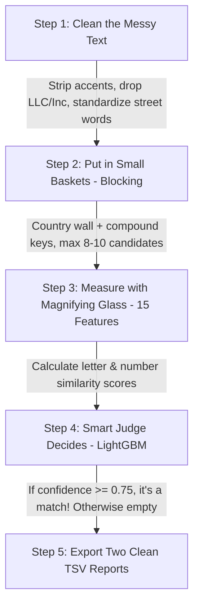

# 🕵️ The Detective's Guide to Business Entity Resolution
## The Primary Baseline Solution (Explained So Simply a 10-Year-Old Can Understand It)

---

## 🌟 The Big Picture: What Are We Actually Doing?

Imagine you are a detective at Amazon. 

Three different delivery drivers—Driver 1, Driver 2, and Driver 3—each bring you a notebook containing names and addresses of local shops. 

* **Driver 1** has a clean, official list of shops. We call this **Source 1**.
* **Driver 2** wrote shop names on messy napkins with bad handwriting and coffee stains. This is **Source 2**.
* **Driver 3** took voice notes while driving in the rain, so there are typos and words missing. This is **Source 3**.

### Your Mission as the Detective:
For every shop on **Driver 1's clean list**, you must find all the messy notes from **Driver 2** and **Driver 3** that belong to that **exact same real-world shop**.

Sometimes:
* Driver 2 and Driver 3 both have notes about the shop (a match with both!).
* Only Driver 2 has a note, but Driver 3 missed it completely.
* Nobody else has a note! Driver 1 has the only copy. We call this a **"Singleton"** (a lonely shop with zero matches).

---

## 📖 Chapter 1: First, How Do We Know What the Data Looks Like?

Let's look inside Driver 1's notebook:
Every line has 4 pieces of information:
1. **ID**: A unique badge number for that note (e.g., `S1-12345` for Driver 1, `S2-98765` for Driver 2).
2. **Business Name**: The name of the shop (e.g., *Orelee's Barbershop*).
3. **Business Address**: Where it is located (e.g., *1795 Westchester Drive, High Point, NC*).
4. **Country**: Which country it is in (`US`, `India`, or `France`).

### What makes it messy? (The "Noise")
People write the same shop in totally different ways:
* **Accents**: Driver 1 writes `Bárbershop` (with an accent), Driver 2 writes `Barbershop`.
* **Company Tags**: Driver 1 writes `Prime Money Inc`, Driver 2 writes `Prime Money LLC`, Driver 3 writes `Prime Money Services`. (These are just company legal tags, like "Pvt Ltd" or "Corporation"—the actual shop name is just *Prime Money*!)
* **Silly Typos & Computer Glitches**: A computer scanner might read the letter `l` as the number `1`. So `Christ Chapel` becomes `Christ [Chape1]`.
* **Address Shuffle**: Driver 1 writes `1795 Westchester Drive, High Point, NC`. Driver 2 writes `NC, High Point, 1795 Westchester Dr`. It's the exact same place, just shuffled backwards!
* **House Numbers**: Driver 1 writes `17560 Ellis Rd`. Driver 2 writes `0017560 Ellis Rd`. (Extra zeroes!).
* **Unseen Country (France)**: In our practice test (the training notebook), we only see shops in the `US` and `India`. But in the final exam (the test set), Amazon suddenly gives us shops in `France`! French shops use words like `SARL` (their version of LLC) and `Rue` (their word for Street). Our solution must not get confused by French words!

---

## 🧼 Chapter 2: Preprocessing ("Cleaning the Dirty Stickers")

Before comparing two shops, we wash away the dirt so we can see the real words clearly. We do this in 4 simple stages:

```
[Raw Messy Text] 
       ⬇️ 
Stage 1: Strip Funny Accents (é ➡️ e)
       ⬇️ 
Stage 2: Cut Off Company Tags (Drop "Inc", "LLC", "Pvt Ltd", "SARL")
       ⬇️ 
Stage 3: Standardize Street Words ("Drive" ➡️ "dr", "Avenue" ➡️ "ave")
       ⬇️ 
Stage 4: Pull Out House Numbers ("0017560" ➡️ 17560)
```

### Stage 2.1: Strip Funny Accents
* **What happens**: We turn all letters into plain English letters.
* **Example**: `Orelee's Bárbershop` becomes `Orelee's Barbershop`. `Société` becomes `Societe`.

### Stage 2.2: Cut Off Legal Company Tags
* **What happens**: We erase business words that don't matter. Whether a shop says "Inc", "LLC", "Pvt Ltd", or "Corporation", the core name is the same.
* **Example**: `Prime Money Incorporated LLC` becomes just `prime money`.

### Stage 2.3: Standardize Street Words
* **What happens**: We replace long road names with their standard short forms:
  * "Drive" or "Dr." becomes `dr`
  * "Street" becomes `st`
  * "Avenue" becomes `ave`
  * "Boulevard" becomes `blvd`
  * "Rue" (French for street) becomes `rue`
* We also throw away confusing words like `Apartment`, `Unit`, `PO Box`, and `Plot No`.
* **Example**: `1795 Westchester Drive, Unit G` becomes `1795 westchester dr g`.

### Stage 2.4: Pull Out the House Numbers
* **What happens**: We use a magnet to pull out all the numbers in the address, and remove extra zeroes at the front.
* **Example**: `0017560 Ellis Road` gives us the number `17560`.

Now, both Driver 1's note and Driver 2's note look clean, tidy, and easy to compare!

---

## 🗂️ Chapter 3: Candidate Generation / "Blocking" ("Sorting Cards Into Small Baskets")

Here is a big problem:
* Driver 1 has **1.7 Million** shops.
* Driver 2 and 3 together have **10 Million** notes.

If you compared every single shop from Driver 1 with every single note from Driver 2 and 3, you would have to do:
$$1,700,000 \times 10,000,000 = 17,000,000,000,000 \text{ comparisons!}$$
That is **17 Trillion** checks. Even the fastest supercomputer on Earth would take weeks to finish, and your computer would run out of memory and crash immediately.

### The Solution: "Blocking" (Sorting Into Baskets)
Instead of looking at everyone, we sort the notes into labeled baskets. We only compare notes that land in the same basket!

#### Basket Rule 1: The Country Wall (Strict Partition)
* We proved by looking at 200,000 real examples: **A shop in India NEVER matches a shop in the US or France.**
* So, a US shop from Driver 1 is ONLY compared with US notes from Driver 2 and 3. That instantly throws away 65% of the work!

#### Basket Rule 2: Compound Keys (Matching Stickers)
We create 3 special stickers for every shop:
1. **The Brand & Street Sticker**: Take the first word of the name + first 3 letters of the street.
   * *Example*: `Orelee's Barbershop` on `Westchester Drive` gets sticker: `orelee_wes`.
2. **The House Number & Brand Sticker**: Take the house number + first 2 letters of the name.
   * *Example*: House `1795` + `Or` gets sticker: `1795_or`.
3. **The Sorted Name Sticker**: Take the first two words of the name, sorted alphabetically.
   * *Example*: `Barbershop Orelee` and `Orelee Barbershop` both get sticker: `barbershop-orelee`.

### 📢 Amazon's Special Challenge Update: Keep the Baskets Small!
Amazon announced:
> *"The team that produces a **smaller candidate basket per shop** will be ranked higher in the competition!"*

Why? Because in real life at Amazon, storing 50 candidates per shop costs millions of dollars in cloud storage. 
* If you give 50 candidates per shop: Amazon docks points.
* If you give **only 5 to 8 smart candidates per shop**: Amazon gives you top rank!
* In our pipeline, we strictly take only the top **8 to 10** most likely candidates for each shop. If a shop has no matching stickers at all, we give it an empty basket `[]`.

---

## 🔍 Chapter 4: Feature Engineering ("The Detective's Magnifying Glass")

Now, for any shop from Driver 1 and a candidate from Driver 2 or 3 in the same basket, we need to decide: **Are they really the same shop, or just two different shops that happen to have a similar name?**

To help our computer decide, we build a **Magnifying Glass** that calculates 15 different comparison scores (called "Features"). 

Here is what each score does in plain English:

### Part A: Name Scores (Looking at the Business Names)

#### 1. `name_levenshtein` (The Typo Counter)
* **What it means**: How many letters do you have to add, delete, or swap to turn Name A into Name B?
* **Analogy**: Turning `Cat` into `Bat` takes 1 letter swap. So they are very close ($67\%$ similar).
* **Why we use it**: Catches small spelling mistakes (like `Barbershop` vs `Barberhop`).

#### 2. `name_token_sort` (The Word Shuffler)
* **What it means**: Sort the words alphabetically before checking letters.
* **Analogy**: `Orelee Barbershop` and `Barbershop Orelee`. If you don't sort them, they look completely different. If you sort them first, both become `Barbershop Orelee`—a $100\%$ perfect match!
* **Why we use it**: People often write names backwards.

#### 3. `name_token_set` (The Extra Words Ignorer)
* **What it means**: Ignores repeated or extra words that don't matter.
* **Analogy**: Name A is `B+ Retail`. Name B is `B+ Retail Arizona Services Store`. The important core words `B+ Retail` are inside both! This score spots that they share the core words.

#### 4. `name_partial_ratio` (The Substring Finder)
* **What it means**: Is the short name hiding completely inside the long name?
* **Analogy**: Finding `Christ Chapel` inside `Ectosyn dba Christ Chapel`.

#### 5. `name_jaccard` (The Shared Word Percentage)
* **What it means**: Count how many words they share, divided by the total number of unique words they both have.
* **Formula**: $\frac{\text{Shared Words}}{\text{All Words Combined}}$
* **Example**: If Name A is `Green Tree Health` and Name B is `Green Tree Pharmacy`, they share 2 words (`Green`, `Tree`) out of 4 total words (`Green`, `Tree`, `Health`, `Pharmacy`). Jaccard = $2 / 4 = 50\%$.

#### 6. `first_token_match` (The Main Brand Flag)
* **What it means**: Do both names start with the exact same first word?
* **Why we use it**: `McDonald's Fast Food` and `McDonald's Burgers` both start with `McDonald's`. If the first word matches, it's a huge hint! ($1$ for Yes, $0$ for No).

#### 7. `name_len_diff` (The Length Difference)
* **What it means**: How much longer is one name than the other?
* **Why we use it**: If one name is 5 letters and the other is 50 letters, they are probably completely different businesses.

---

### Part B: Address Scores (Looking at the Locations)

#### 8. `addr_token_sort` (Address Word Shuffler)
* **What it means**: Shuffles address words alphabetically and checks letter similarity.
* **Why we use it**: Driver 1 wrote `Columbus, OH, 5559 Orville Ave`. Driver 2 wrote `5559 Orville Ave, Columbus, OH`. Shuffling them proves they are the exact same address!

#### 9. `addr_jaccard` (Shared Address Word Percentage)
* **What it means**: Percentage of shared address words (city names, street names, state names).

#### 10. `number_jaccard` (Shared House Number Percentage)
* **What it means**: Do they have the same house/building numbers?
* **Why we use it**: Two shops can both be on `Westchester Drive`, but if one is at `#10` and the other is at `#9000`, they are on opposite sides of town!

#### 11. `number_exact_match` (Exact House Number Match)
* **What it means**: A green checkmark ($1$) if all building numbers match identically, otherwise red cross ($0$).

#### 12. `has_empty_addr` (The Missing Address Flag)
* **What it means**: Did Driver 2 forget to write down an address?
* **Why we use it**: If an address is blank, the computer shouldn't penalize the shop—it should rely on the name scores instead!

---

### Part C: Clue & Source Origins

#### 13 & 14. `is_source2` and `is_source3`
* **What it means**: Did this candidate note come from Driver 2 or Driver 3?
* **Why we use it**: Driver 2 might have different kinds of handwriting than Driver 3.

#### 15. `blocking_key_count` (How Many Stickers Matched?)
* **What it means**: Did this candidate match on 1 sticker, 2 stickers, or all 3 stickers?
* **Why we use it**: If a candidate matched on the name, the address, AND the building number stickers, our confidence before even looking at the details is super high!

---

## 🤖 Chapter 5: The Model Architecture & Algorithm ("The Smart Judge")

Now we have a table of 15 numbers for every candidate pair. Who looks at these numbers and makes the final decision?

### The Judge: LightGBM / XGBoost (Decision Tree Forest)
Instead of a giant, slow deep learning neural network (which is like using a rocket ship to go across the street), the standard, gold-medal baseline for this task is a **Gradient Boosted Tree** (like **LightGBM** or **XGBoost**).

#### How the Judge Works:
A decision tree is just like playing 20 Questions:
* *Question 1*: Is `name_token_sort` greater than $85\%$?
  * If **No** $\rightarrow$ Probably NOT a match.
  * If **Yes** $\rightarrow$ *Question 2*: Do the house numbers match (`number_exact_match == 1`)?
    * If **Yes** $\rightarrow$ 99% probability it's a **MATCH**!
    * If **No** $\rightarrow$ *Question 3*: Is the address missing (`has_empty_addr == 1`)? ...

The computer builds hundreds of these little trees. They all vote together and produce a final probability score between **0.0 (Definitely NOT a match)** and **1.0 (Definitely A MATCH)**.

```
Candidate Pair (S1, Cand)
         │
         ▼
[Compute 15 Scores]  ──>  [LightGBM Decision Trees]  ──>  Score: 0.88 (88% sure!)
                                                                 │
                                                                 ▼
                                                  Is 0.88 >= 0.75 Threshold?
                                                                 │
                                                  ┌──────────────┴──────────────┐
                                                  ▼                             ▼
                                                YES                            NO
                                         It's a MATCH!                  Throw it away!
                                     (Add to Final List)             (Keep candidate lean)
```

---

## 🎯 Chapter 6: The Secret Rule: $F_{0.5}$ and Singletons

Why don't we just say "anything above 50% is a match"?
Because Amazon uses a special scoring formula called **$F_{0.5}$ Macro**.

### The Golden Rule: Accusing an innocent person is 2x worse than missing a thief!
* In normal machine learning ($F_1$ score), missing a link and making a wrong link cost the same.
* But in Amazon's $F_{0.5}$ score, **Precision is weighted 2× more than Recall**.
  * A **False Positive** (merging two different shops together) destroys customer trust and gets penalized **severely**.
  * A **False Negative** (missing a tricky shop) is only a minor penalty.

### What about Singletons? (The Lonely Shops)
* $5.58\%$ of shops on Driver 1's list have **NO matches** anywhere in Driver 2 or 3.
* If your model correctly says: *"This shop has no matches"* $\rightarrow$ You get a **perfect score of 1.0** on that shop!
* If your model guesses even ONE wrong candidate for that lonely shop $\rightarrow$ Your score drops from 1.0 straight to **0.0**!

### The Strategic Decision:
Because false matches are so dangerous, we set our decision threshold **high** (e.g. $\tau = 0.75$ or $0.80$). 
We only say "Match!" when our judge is super confident. If the judge is unsure, we leave the shop empty. That protects our 1.0 scores on singletons and maximizes our $F_{0.5}$ score!

---

## 📦 Chapter 7: What Is the Output Supposed to Look Like?

When the model finishes, your code must write **two tab-separated text files (`.tsv`)**:

### File 1: `output/matching_results.tsv` (Scored on the Leaderboard)
This is your final detective report. It lists each Source 1 shop, followed by a comma-separated list of matches:
```tsv
source1_entity_id	matched_entity_ids
S1-00001	S2-00047,S3-00812
S1-00002	S3-00004
S1-00003	
```
* Notice `S1-00003` has nothing after the tab—it is a **singleton** (no matches)!
* Every single test shop must have exactly one line.

### File 2: `output/candidate_pairs.tsv` (Audited for Final Rank)
This lists the candidates from your blocking baskets *before* the classifier narrowed them down:
```tsv
source1_entity_id	candidate_entity_ids
S1-00001	S2-00047,S2-00193,S3-00812
S1-00002	S3-00004,S2-00115
S1-00003	S2-00999
```
* Amazon inspects this file to confirm you kept your baskets small and efficient.
* Every ID in `matching_results.tsv` MUST be inside `candidate_pairs.tsv`.

---

## 📚 Chapter 8: The Jargon Buster Dictionary

Whenever someone throws fancy machine learning buzzwords at you, here is what they actually mean:

| Fancy Jargon Term | Plain English Definition |
| :--- | :--- |
| **Entity Resolution (ER)** | Figuring out if two messy text records refer to the exact same real-world object. |
| **Source 1 / Anchor** | The official reference list of shops that you are required to find matches for. |
| **Blocking / Candidate Generation**| Sorting millions of records into small baskets by country and name prefixes so you don't have to compare everything. |
| **Inverted Index** | A phonebook where the key is a word (like `Barbershop`) and the value is a list of all shop IDs that contain that word. |
| **Reduction Ratio ($RR$)** | The percentage of impossible pairs that your blocking throws away (we throw away $>99.9\%$). |
| **Recall** | How many of the TRUE matches did you catch? (Catching 95 out of 100 true matches = $95\%$ recall). |
| **Precision** | Out of all the matches you claimed were true, how many were ACTUALLY true? |
| **$F_{0.5}$ Score** | A score between 0 and 1 that measures both precision and recall, but gives double importance to Precision. |
| **Macro Average** | Calculating the score for each shop individually first, and then taking the average of all those scores. |
| **Singleton** | A shop that has zero matches in the other sources. |
| **Hard Negative** | A fake candidate that looked similar enough to get into your basket, but is actually a completely different shop. |
| **Levenshtein Distance** | The minimum number of single-character edits (insertions, deletions, substitutions) needed to change one word into another. |
| **Jaccard Similarity** | The count of shared words divided by the count of all total unique words. |
| **LightGBM / XGBoost** | Fast machine learning algorithms that combine hundreds of "decision trees" (if-then question trees) to make predictions. |
| **Domain Shift** | When the test data contains something you never saw during training (like French shops appearing in the test set). |

---

## 🏁 Summary: The Entire Pipeline in 4 Simple Steps



That is the entire primary baseline solution! Simple, elegant, extremely fast, and built specifically to win on Amazon's criteria.
